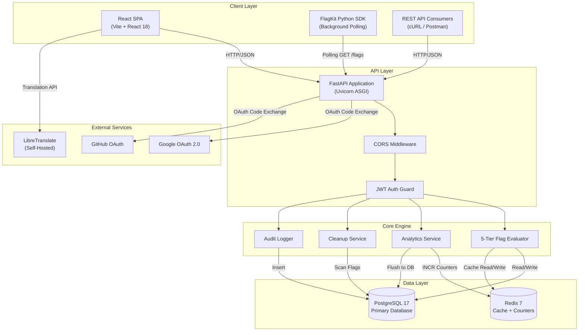
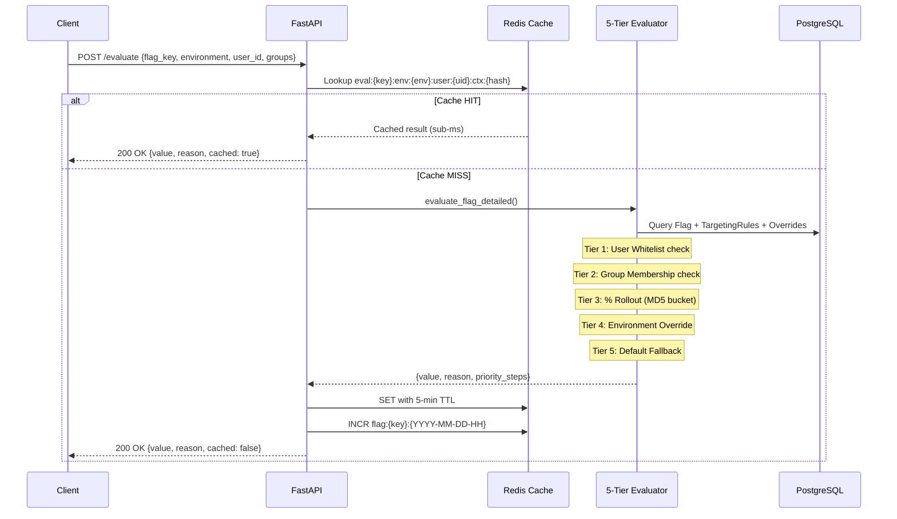
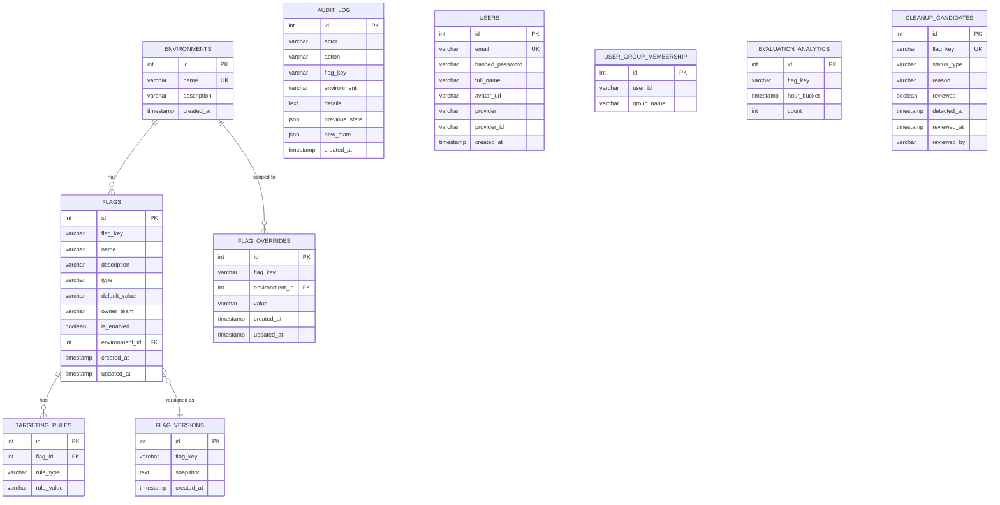
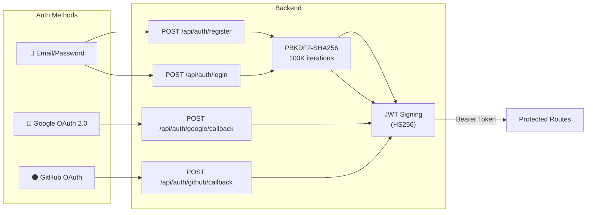
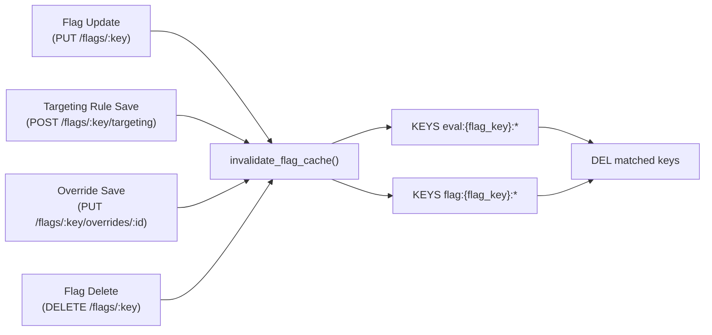
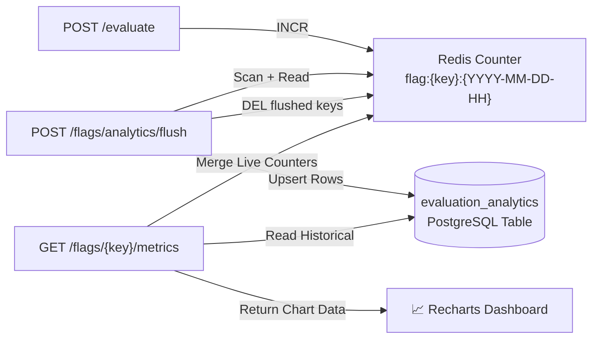
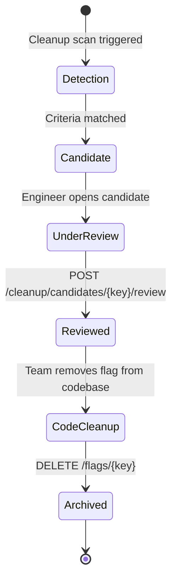

# FlagForge — Application Feature Planning & Release Governance System

FlagForge is an enterprise-grade feature flag management and release governance platform. It allows engineering teams to create flags, configure 5-tier targeting rules, execute instant environment toggles, monitor real-time evaluation analytics, maintain audit compliance, and automate stale flag cleanup — all backed by sub-millisecond Redis caching and a resilient client SDK.

---

## ⭐️ Completed Milestones Overview

### 🚩 Milestone 1: Core Engine & Flag Management
- **Database Schema Architecture**: Environments, Flags, Flag Overrides, Audit Logs, and User Groups.
- **5-Tier Flag Evaluator**: Deterministic resolution precedence (Whitelist > Groups > Rollout % > Env Override > Default Fallback).
- **Interactive UI Dashboard**: Environment toggles, flag catalog, and detail editor.

### ⚡ Milestone 2: Advanced Targeting, Caching & SDK
- **Granular Target Rules**: User whitelist parsing, group membership targeting, and deterministic MD5 percentage rollouts (0-100%).
- **Sub-Millisecond Redis Caching**: Evaluation caching (`eval:*`) with automated invalidation on rule mutations.
- **FlagKit Python SDK & Middleware**: Background polling client library (`FlagClient`) and FastAPI middleware (`FlagKitMiddleware`).
- **Audit Logging**: Full audit trail recording actor, action, previous state, and new state.

### 🚀 Milestone 3: Telemetry Analytics, Governance & Internationalization
- **Evaluation Analytics Pipeline**: Hourly Redis counters (`flag:{key}:{YYYY-MM-DD-HH}`) flushed to database with trend charts.
- **Stale Flag Cleanup Governance**: Detection of fully rolled-out (100%) or disabled flags (>30 days) with review tracking.
- **Dual Translation Engine**: Switchable translation engine in Settings (Google Translate Widget vs LibreTranslate) supporting 10 languages (English, Spanish, German, Hindi, Telugu, Marathi, Gujarati, Bengali, Tamil, Arabic).
- **Comprehensive Test Suite**: 42 automated Pytest test cases covering evaluators, cache invalidation, audit accuracy, and load benchmarks.

---

## 🛠 Tech Stack

- **Backend**: FastAPI, SQLAlchemy, PostgreSQL, Redis, Alembic, Pytest
- **Client SDK**: Custom `flagkit` Python SDK & FastAPI Middleware
- **Frontend**: React 18, Vite, React Router v6, Recharts, Vanilla CSS
- **Containerization**: Docker & Docker Compose

---

## 📂 Project Structure

```text
Application-Feature-Planning-System/
├── backend/
│   ├── app/
│   │   ├── core/           # Config, DB, Evaluator, Redis Client, Security
│   │   ├── models/         # SQLAlchemy models (Flag, Environment, AuditLog, etc.)
│   │   ├── routers/        # API Endpoints (Flags, Environments, Audit, Cleanup, Auth)
│   │   ├── schemas/        # Pydantic schemas
│   │   └── services/       # Analytics & Cleanup background services
│   ├── tests/              # 42 Pytest test cases across 13 test modules
│   ├── alembic/            # Database migration scripts
│   ├── README.md           # Backend setup & API reference guide
│   └── requirements.txt    # Python dependencies
├── flagkit/                # Custom Python SDK & FastAPI Middleware
│   ├── client.py           # FlagClient polling SDK
│   └── middleware.py       # FastAPI middleware integration
├── frontend/
│   ├── src/
│   │   ├── components/     # UI Components (Flags, Settings, Layout, Widgets)
│   │   ├── context/        # React Context (Auth, Environment, Translation)
│   │   ├── pages/          # Dashboard, Flags, FlagDetail, AuditLog, Teams, Settings
│   │   └── index.css       # Responsive CSS design system
│   ├── README.md           # Frontend setup guide
│   └── package.json        # Node dependencies
├── docker-compose.yml      # PostgreSQL + Redis container orchestrator
└── Readme.md               # Main repository documentation
```

---

## 🚀 Quick Start

### 1. Start Infrastructure via Docker
```bash
docker-compose up -d db redis
```

### 2. Start Backend Server
```bash
cd backend
python -m venv venv
# Activate virtual environment
.\venv\Scripts\Activate.ps1   # Windows
source venv/bin/activate      # Linux/macOS

pip install -r requirements.txt
alembic upgrade head
python -m uvicorn app.main:app --port 8000
```

### 3. Start Frontend Dashboard
```bash
cd frontend
npm install
npm run dev
```
Open **[http://localhost:5173](http://localhost:5173)** to access FlagForge.

---

## 🧪 Testing

Execute the complete backend test suite (42 test cases):
```bash
cd backend
pytest tests/ -v
```

---

## 📖 Component Documentation
- **[Backend Guide & API Reference](backend/README.md)**
- **[Frontend Guide & Dashboard Overview](frontend/README.md)**

---

## 🏗 Architecture Deep Dive

FlagForge follows a decoupled three-tier architecture with a clear separation between the React SPA frontend, the FastAPI backend API, and infrastructure services (PostgreSQL + Redis).

### System Architecture Diagram



### Request Flow: Flag Evaluation



---

## 🗄 Database Schema

FlagForge uses **10 relational tables** managed via SQLAlchemy ORM and Alembic migrations.

### Entity-Relationship Diagram



### Table Descriptions

| Table | Purpose | Key Columns |
|:------|:--------|:------------|
| `environments` | Deployment stages (dev, staging, prod) | `name`, `description` |
| `flags` | Feature flag definitions, one row per flag per environment | `flag_key`, `type`, `is_enabled`, `environment_id` |
| `targeting_rules` | Per-flag targeting: whitelist, group, percentage | `flag_id`, `rule_type`, `rule_value` |
| `flag_overrides` | Environment-specific value overrides | `flag_key`, `environment_id`, `value` |
| `flag_versions` | Point-in-time configuration snapshots for rollback | `flag_key`, `snapshot` |
| `audit_log` | Immutable compliance trail for every mutation | `actor`, `action`, `previous_state`, `new_state` |
| `users` | Registered user accounts (email + OAuth) | `email`, `provider`, `hashed_password` |
| `user_group_membership` | Maps user IDs to named groups for group targeting | `user_id`, `group_name` |
| `evaluation_analytics` | Hourly aggregated evaluation counts flushed from Redis | `flag_key`, `hour_bucket`, `count` |
| `cleanup_candidates` | Stale flags detected for governance review | `flag_key`, `status_type`, `reviewed` |

---

## 🔐 Authentication System

FlagForge supports **three authentication methods**, all issuing HS256-signed JWT access tokens with 7-day expiry.

### Authentication Flow Diagram



### Auth Endpoints Reference

| Method | Endpoint | Description |
|:-------|:---------|:------------|
| `POST` | `/api/auth/register` | Create new account with email + password (min 6 chars) |
| `POST` | `/api/auth/login` | Authenticate via email + password, returns JWT |
| `POST` | `/api/auth/google/callback` | Exchange Google authorization code for JWT |
| `POST` | `/api/auth/github/callback` | Exchange GitHub authorization code for JWT |
| `GET` | `/api/auth/me` | Fetch current authenticated user profile |
| `GET` | `/api/auth/users` | List all registered platform users |

### Default Admin Account

On startup, a default admin user is automatically seeded:
- **Email**: `admin@flagforge.com`
- **Password**: `admin123`

---

## ⚙️ 5-Tier Flag Evaluation Engine

The core of FlagForge is a **deterministic 5-tier evaluation engine** that resolves flag values in strict priority order. The first matching tier wins — no further tiers are checked.

### Evaluation Priority Cascade

```
┌─────────────────────────────────────────────────────────┐
│  TIER 1: User Whitelist (Highest Priority)              │
│  ───────────────────────────────────────                 │
│  Checks if user_id appears in the comma-separated       │
│  whitelist rule. If matched → returns TRUE immediately.  │
├─────────────────────────────────────────────────────────┤
│  TIER 2: Group Targeting                                │
│  ───────────────────────────────────────                 │
│  Checks if any of the user's groups (request + DB)      │
│  match the flag's targeted groups.                      │
├─────────────────────────────────────────────────────────┤
│  TIER 3: Percentage Rollout                             │
│  ───────────────────────────────────────                 │
│  Computes MD5("{user_id}:{flag_key}") → bucket 0-99.    │
│  If bucket < rollout_percentage → flag is ON.           │
│  Deterministic: same user always gets same result.      │
├─────────────────────────────────────────────────────────┤
│  TIER 4: Environment Override                           │
│  ───────────────────────────────────────                 │
│  Checks flag_overrides table for environment-specific   │
│  value. Supports boolean, string, and number types.     │
├─────────────────────────────────────────────────────────┤
│  TIER 5: Default Value Fallback (Lowest Priority)       │
│  ───────────────────────────────────────                 │
│  Returns the flag's configured default_value.           │
│  For disabled flags, returns FALSE (boolean) or default.│
└─────────────────────────────────────────────────────────┘
```

### Percentage Rollout Algorithm

The rollout uses **MD5 hashing** for deterministic, uniformly distributed user bucketing:

```python
def calculate_user_bucket(user_id: str, flag_key: str) -> int:
    raw_key = f"{user_id}:{flag_key}"
    hash_hex = hashlib.md5(raw_key.encode('utf-8')).hexdigest()
    hash_int = int(hash_hex, 16)
    return hash_int % 100  # Returns bucket 0-99
```

**Key properties:**
- **Deterministic**: The same `user_id + flag_key` pair always produces the same bucket.
- **Uniformly distributed**: Across large user populations, buckets spread evenly (verified by test suite).
- **Independent per flag**: Changing one flag's rollout doesn't affect another flag's user assignment.

### Evaluation Response Structure

Every evaluation returns a rich diagnostic response:

```json
{
  "flag_key": "new_checkout_flow",
  "value": true,
  "type": "boolean",
  "environment": "Production",
  "is_enabled": true,
  "reason": "PERCENTAGE_ROLLOUT",
  "matched_rule": "PERCENTAGE_ROLLOUT",
  "rule_detail": "User hash bucket 42 <= 75% rollout threshold",
  "latency_ms": 0.18,
  "cached": false,
  "priority_steps": [
    {"priority": 1, "name": "User Targeting", "status": "No match"},
    {"priority": 2, "name": "Group Targeting", "status": "No match"},
    {"priority": 3, "name": "% Rollout", "status": "Matched"},
    {"priority": 4, "name": "Env Override", "status": "Skipped"},
    {"priority": 5, "name": "Default Value", "status": "Skipped"}
  ],
  "evaluated_at": "10 Aug 2026, 10:30:45 PM",
  "request_summary": {
    "flag_key": "new_checkout_flow",
    "environment": "Production",
    "user_id": "user_42",
    "groups": ["beta_users"]
  }
}
```

---

## 🚀 Redis Caching Architecture

FlagForge uses Redis for two distinct purposes: **evaluation caching** and **analytics counters**.

### Cache Key Schema

| Pattern | Purpose | TTL |
|:--------|:--------|:----|
| `eval:{flag_key}:env:{env}:user:{uid}:ctx:{md5_hash}` | Cached evaluation result | 300s (5 min) |
| `flag:{flag_key}:{YYYY-MM-DD-HH}` | Hourly evaluation counter | No TTL (flushed to DB) |

### Cache Invalidation Strategy

Cache invalidation is **targeted and immediate** — only the affected flag's cache entries are purged:



**Important behaviors:**
- Mutations trigger `invalidate_flag_cache(flag_key)` which deletes all `eval:{key}:*` and `flag:{key}:*` keys.
- Group deletions trigger `invalidate_all_eval_cache()` which purges all `eval:*` keys globally.
- Cache misses always fall through to the database evaluator and re-populate the cache.
- If Redis is unreachable, the system degrades gracefully — evaluations proceed from the database with in-memory counter fallback.

---

## 📊 Evaluation Analytics Pipeline

FlagForge tracks flag evaluation volume through a **Redis → PostgreSQL flush pipeline**.

### Pipeline Flow



### Analytics Endpoints

| Method | Endpoint | Description |
|:-------|:---------|:------------|
| `POST` | `/flags/analytics/flush` | Flush Redis hourly counters → PostgreSQL |
| `GET` | `/flags/{key}/metrics?timeframe=30D` | Retrieve evaluation metrics (7D/30D/90D) with chart data |
| `POST` | `/flags/{key}/seed-analytics?days=30` | Generate sample data for demos |
| `POST` | `/flags/{key}/clear-analytics` | Clear analytics records for a flag |

### Metrics Response

The metrics endpoint returns chart-ready data with period-over-period comparison:

```json
{
  "flag_key": "new_checkout_flow",
  "timeframe": "30D",
  "total_evaluations": 285420,
  "previous_total": 245100,
  "change_percentage": 16.5,
  "is_positive": true,
  "data": [
    {"date": "Jul 12", "full_date": "2026-07-12", "count": 9514},
    {"date": "Jul 13", "full_date": "2026-07-13", "count": 10230}
  ]
}
```

---

## 🧹 Stale Flag Cleanup & Governance

FlagForge automatically detects stale feature flags that should be cleaned up from the codebase.

### Detection Criteria

A flag is identified as a **cleanup candidate** if it meets either condition:

| Status Type | Condition | Rationale |
|:------------|:----------|:----------|
| `ROLLED_OUT` | Flag enabled AND rollout percentage = 100% for ≥ threshold days | Flag is fully deployed; hard-code the behavior and remove the flag |
| `DISABLED` | Flag disabled across all environments for ≥ threshold days | Dead code; safe to remove |

### Governance Workflow



### Cleanup Endpoints

| Method | Endpoint | Description |
|:-------|:---------|:------------|
| `GET` | `/cleanup/candidates?threshold_days=30` | List stale flag candidates |
| `POST` | `/cleanup/evaluate?threshold_days=30` | Trigger on-demand detection scan |
| `POST` | `/cleanup/candidates/{flag_key}/review` | Mark candidate as reviewed/unreviewed |

---

## 🌐 Dual Translation Engine

FlagForge offers two switchable internationalization engines, configurable from the Settings page.

### Engine Comparison

| Feature | Google Translate Widget | LibreTranslate (Self-Hosted) |
|:--------|:-----------------------|:-----------------------------|
| **Privacy** | Data sent to Google servers | 100% self-hosted, no external calls |
| **Deployment** | Embedded `<script>` tag | Docker container (`localhost:5000`) |
| **Languages** | 100+ languages | 10 configured languages |
| **Latency** | Instant (client-side DOM rewrite) | REST API call per translation batch |
| **Offline** | ❌ Requires internet | ✅ Works fully offline |

### Supported Languages (LibreTranslate)

English, Spanish (`es`), French (`fr`), German (`de`), Hindi (`hi`), Chinese (`zh`), Japanese (`ja`), Arabic (`ar`), Portuguese (`pt`), Russian (`ru`)

---

## 👥 User Groups & Team Management

FlagForge includes a full group management system for organizing users into targeting cohorts.

### Groups API

| Method | Endpoint | Description |
|:-------|:---------|:------------|
| `GET` | `/groups` | List all user groups (auto-seeds defaults if empty) |
| `POST` | `/groups` | Create a new group |
| `DELETE` | `/groups/{name}` | Delete a group |
| `POST` | `/groups/batch-delete` | Bulk delete multiple groups |
| `GET` | `/groups/{name}/members` | List members of a group |
| `POST` | `/groups/{name}/members` | Add a user to a group |
| `DELETE` | `/groups/{name}/members/{user_id}` | Remove a user from a group |

### Default Groups (Auto-Seeded)

`beta_users`, `premium_plan`, `internal_team`, `qa_team`, `support_team`, `enterprise_cust`, `india_users`, `android_users`

---

## 🌍 Environment Management

FlagForge supports **unlimited deployment environments** with full CRUD operations. Three environments are seeded on startup.

### Default Environments

| Name | Description |
|:-----|:------------|
| `development` | For developers to test features |
| `staging` | QA & pre-production testing |
| `production` | Live environment for end users |

### Environment API

| Method | Endpoint | Description |
|:-------|:---------|:------------|
| `GET` | `/environments` | List all environments |
| `POST` | `/environments` | Create new environment (auto-populates all existing flags) |
| `GET` | `/environments/{id}` | Get environment details |
| `PUT` | `/environments/{id}` | Update name or description |
| `DELETE` | `/environments/{id}` | Delete environment (cascades flags, rules, overrides) |

> **Note:** When a new environment is created, FlagForge automatically creates a corresponding flag entry (disabled by default) for every existing flag key, ensuring all flags are queryable across all environments.

---

## 🔑 Environment Variables Reference

Create a `.env` file in the `backend/` directory with the following variables:

| Variable | Required | Default | Description |
|:---------|:---------|:--------|:------------|
| `DATABASE_URL` | ✅ | — | PostgreSQL connection string |
| `REDIS_URL` | ✅ | — | Redis connection string |
| `JWT_SECRET` | ✅ | — | Secret key for HS256 JWT signing |
| `FRONTEND_ORIGIN` | ✅ | — | CORS allowed origin for the React frontend |
| `GOOGLE_CLIENT_ID` | ⬜ | — | Google OAuth 2.0 client ID |
| `GOOGLE_CLIENT_SECRET` | ⬜ | — | Google OAuth 2.0 client secret |
| `GOOGLE_REDIRECT_URI` | ⬜ | — | Google OAuth redirect URI |
| `GITHUB_CLIENT_ID` | ⬜ | — | GitHub OAuth application client ID |
| `GITHUB_CLIENT_SECRET` | ⬜ | — | GitHub OAuth application client secret |
| `GITHUB_REDIRECT_URI` | ⬜ | — | GitHub OAuth redirect URI |

---

## 🐳 Docker Services Reference

The `docker-compose.yml` orchestrates three infrastructure containers:

| Service | Image | Container Name | Port | Purpose |
|:--------|:------|:---------------|:-----|:--------|
| PostgreSQL | `postgres:17` | `feature_postgres` | `5432` | Primary relational database |
| Redis | `redis:7` | `feature_redis` | `6379` | Evaluation cache + analytics counters |
| LibreTranslate | `libretranslate/libretranslate` | `feature_libretranslate` | `5000` | Self-hosted translation API |

### Data Persistence

PostgreSQL data is persisted via a named Docker volume (`postgres_data`). Redis operates as an ephemeral cache — data loss on restart is expected and handled gracefully.

---

## 🧪 Complete Test Suite Reference

FlagForge includes **42 automated test cases** across **13 test modules**, covering unit tests, integration tests, load benchmarks, and end-to-end scenarios.

### Test Module Breakdown

| Module | Tests | Coverage Area |
|:-------|:------|:--------------|
| `test_evaluator.py` | 5-tier hierarchy, disabled flags, default fallbacks | Core evaluation engine |
| `test_targeting_rules.py` | Whitelist parsing, group matching, percentage rollout determinism, statistical distribution | Targeting rule logic |
| `test_cache_invalidation.py` | Cache key determinism, isolated invalidation, cross-flag isolation | Redis cache behavior |
| `test_caching.py` | Cache hit/miss, TTL expiry, stale data prevention | Caching layer |
| `test_audit_log_accuracy.py` | Multi-field filtering, chronological ordering, state capture accuracy | Audit compliance |
| `test_load_evaluation.py` | Sequential throughput, multi-threaded concurrent evaluation | Performance benchmarks |
| `test_cleanup.py` | Stale flag detection, review workflow, threshold configuration | Governance system |
| `test_auth.py` | Password hashing, JWT creation/validation, token expiry | Authentication |
| `test_analytics.py` | Hourly key formatting, counter increments, flush pipeline | Analytics pipeline |
| `test_flagkit.py` | SDK cache refresh, `is_enabled()`, `get_value()`, type coercion | FlagKit SDK |
| `test_flagkit_middleware.py` | FastAPI middleware integration, request-scoped client | SDK middleware |
| `test_milestone2_integration.py` | Cross-component integration scenarios | Integration tests |
| `test_e2e_system.py` | Full create → evaluate → audit → cleanup lifecycle | End-to-end tests |

### Running Tests

```bash
# Run entire suite
cd backend
pytest tests/ -v

# Run a specific module
pytest tests/test_evaluator.py -v

# Run with coverage report
pytest tests/ -v --tb=short
```

---

## 🔧 Troubleshooting

### Common Issues & Solutions

| Symptom | Cause | Fix |
|:--------|:------|:----|
| `Connection refused` on port 5432 | PostgreSQL container not running | Run `docker-compose up -d` |
| `Connection refused` on port 6379 | Redis container not running | Run `docker-compose up -d` |
| `CORS errors` in browser console | Frontend origin mismatch | Verify `FRONTEND_ORIGIN` in `.env` matches your Vite dev URL |
| `alembic upgrade head` fails | Database schema mismatch | Try `alembic downgrade base` then `alembic upgrade head` |
| Evaluation always returns cached result | Stale Redis cache | Restart Redis or call the flag update endpoint to trigger invalidation |
| LibreTranslate translations fail | Container not ready or downloading models | Wait 2-3 minutes after first start for language models to download |
| Google/GitHub OAuth fails | Invalid client credentials | Verify OAuth client ID/secret in `.env` |
| `Flag not found` after creation | Wrong environment selected | Ensure the `?environment=` query parameter matches (default: `development`) |

### Health Check

Verify system health via the built-in endpoint:

```bash
curl http://localhost:8000/health
```

Expected response:
```json
{
  "status": "healthy",
  "redis": "connected",
  "database": "connected"
}
```

---

## 🤝 Contributing

1. **Fork** the repository.
2. **Create** a feature branch: `git checkout -b feature/my-feature`.
3. **Commit** changes with descriptive messages.
4. **Push** to your fork and open a **Pull Request**.

### Code Standards

- **Backend**: Python 3.10+, type hints, PEP 8 formatting.
- **Frontend**: React functional components, hooks-based state management.
- **Tests**: All new features must include corresponding Pytest test cases.
- **Audit Trail**: All data mutations must write to the `audit_log` table.

---

## 📜 License

This project is developed as part of the **Springboard Internship Program 2026**.
